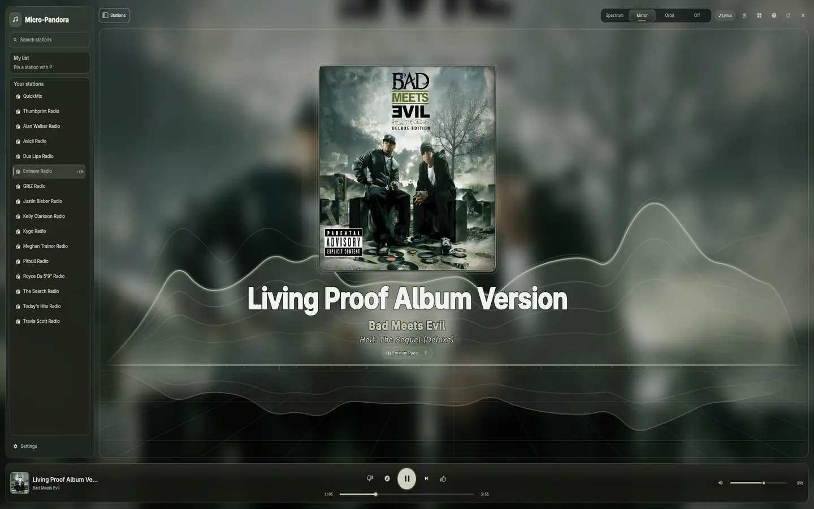
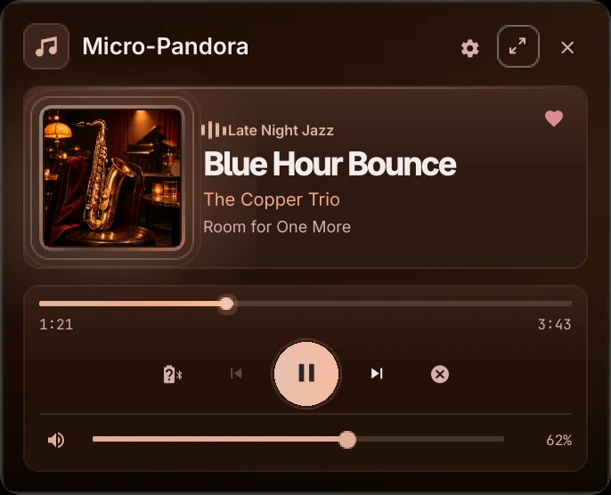
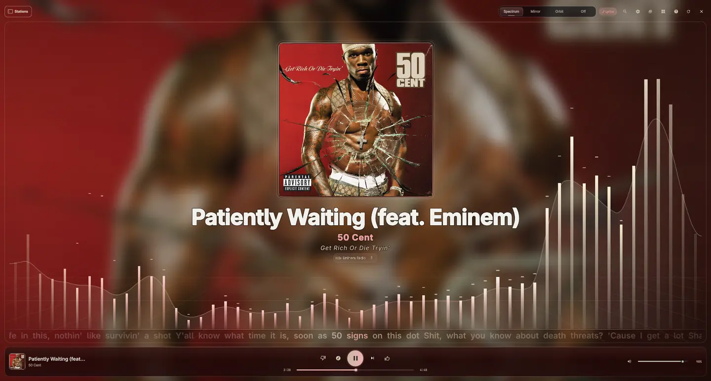
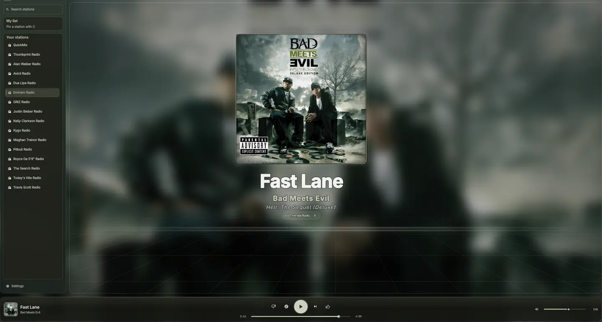

# Micro-Pandora

Micro-Pandora is a Pandora player for the Omarchy desktop. Open it from the launcher or use the mini player on the bar. The full player enlarges the current album cover into a soft backdrop behind the sharp artwork and live visualizer. Both players pick up the album’s colors. Sign in from Micro-Pandora’s Settings and use Pithos as the playback backend.

[](docs/layout.md#screenshots)

<details>
<summary>Mini player and visualizer screenshots</summary>

[](docs/screenshots/mini-player.webp)

| Spectrum | Mirror |
| --- | --- |
| [](docs/screenshots/spectrum.webp) | [](docs/screenshots/mirror.webp) |

| Orbit | Off |
| --- | --- |
| [](docs/screenshots/orbit.webp) | [](docs/screenshots/off.webp) |

</details>

See the [player layout guide](docs/layout.md#screenshots) for full-size screenshots and control details.

## Install

On a current Omarchy desktop, extract the [latest release](https://github.com/micro23/Micro-Pandora/releases/latest) and run `./scripts/setup.sh` from the extracted folder. You can also install from GitHub:

```bash
git clone https://github.com/micro23/Micro-Pandora.git
cd Micro-Pandora
./scripts/setup.sh
```

Setup installs the missing packages, enables the player, and registers **Micro-Pandora** in the app launcher. It uses Omarchy’s package tools, which can prompt for your system password or AUR review.

If you installed Micro-Pandora before v0.5.10, follow the [upgrade steps](docs/install.md#upgrade-from-v059-or-earlier) to switch to the new plugin ID and keep your pinned stations.

## Remove

Run `omarchy plugin remove io.github.micro23.micro-pandora` to remove the plugin and its bar widget. See the [removal guide](docs/uninstall.md) for removing the launcher and optional local data.

## Use

- Left-click the music note in the bar for the mini player. Right-click for the full player.
- On first use, enter your Pandora email and password in **Settings**, then choose **Save and connect**. The password stays in the desktop keyring on that computer.
- Pithos runs on a hidden workspace by default. **Settings → Show Pithos window** opens the native interface when you need it.
- Select a station in the sidebar. Use the pin next to the station name to keep it in **My list**. Press **Ctrl+B** or click the sidebar icon beside **Now playing** to hide or show the station column.
- The full player has play, pause, skip, volume, and mute controls. Progress is read-only because Pandora doesn’t offer seeking here.
- Choose **Spectrum**, **Mirror**, **Orbit**, or **Off** in the header. Press **V** to cycle through all four. Pandora keeps playing in **Off** mode.
- Open **Settings → App updates** to check for a release and install it when you’re ready. Background checks can be turned off there.

See [installation](docs/install.md), [keyboard shortcuts](docs/keyboard.md), and [troubleshooting](docs/troubleshooting.md) for more.

## Credits

Micro-Pandora is based on [OmaPandora by Dankestrick](https://github.com/Dankestrick/OmaPandora), which was built on [OmaSpotify](https://github.com/jeremylanger/omaspotify). See the [MIT license](LICENSE) for the original copyright notices.
