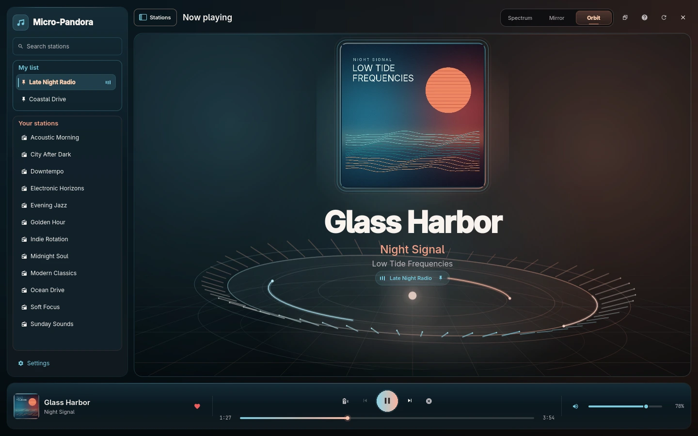

# Micro-Pandora

Micro-Pandora is a Pandora player for the Omarchy desktop. Open it from the launcher or use the mini player on the bar. Both players use the current album’s artwork and colors. Sign in from Micro-Pandora’s Settings and use Pithos as the playback backend.



## Install

On a current Omarchy desktop, download and extract the [release archive](https://github.com/micro23/Micro-Pandora/releases), then run this from the extracted folder:

```bash
./scripts/setup.sh
```

Setup installs the missing packages, enables the player, and registers **Micro-Pandora** in the app launcher. It uses Omarchy’s package tools, which can prompt for your system password or AUR review. The release includes a SHA-256 checksum.

Micro-Pandora keeps the original `io.github.dankestrick.omapandora` plugin ID for compatibility with existing bar layouts, keyboard shortcuts, and synced installations. Apply the incoming **Micro-Pandora** plugin through **Omarchy Config Sync** to update an existing synced install. Restart the Omarchy shell if it is still showing the previous version. **Settings → Install dependencies** fills in any missing packages.

## Use

- Left-click the music note in the bar for the mini player. Right-click for the full player.
- On first use, enter your Pandora email and password in **Settings**, then choose **Save and connect**. The password stays in the desktop keyring on that computer.
- Pithos runs on a hidden workspace by default. **Settings → Show Pithos window** opens the native interface when you need it.
- Select a station in the sidebar. Use the pin next to the station name to keep it in **My list**. Press **Ctrl+B** or click the sidebar icon beside **Now playing** to hide or show the station column.
- The full player has play, pause, skip, volume, and mute controls. Progress is read-only because Pandora doesn’t offer seeking here.
- Click **Spectrum**, **Mirror**, or **Orbit** in the header to switch directly. Press **V** to cycle through the three views.

See [installation](docs/install.md), [keyboard shortcuts](docs/keyboard.md), and [troubleshooting](docs/troubleshooting.md) for more.

## Credits

Micro-Pandora is based on [OmaPandora by Dankestrick](https://github.com/Dankestrick/OmaPandora), which was built on [OmaSpotify](https://github.com/jeremylanger/omaspotify). See the [MIT license](LICENSE) for the original copyright notices.
