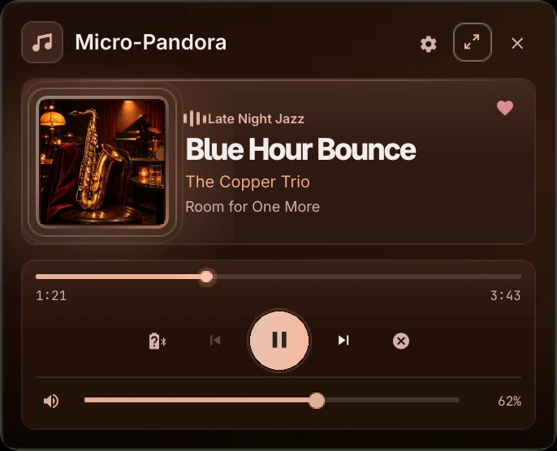
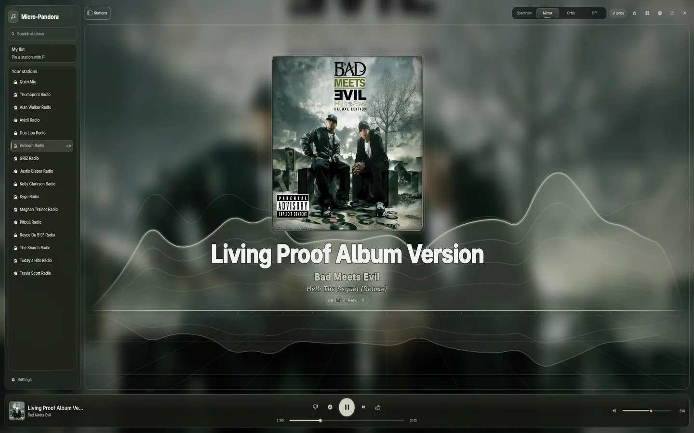
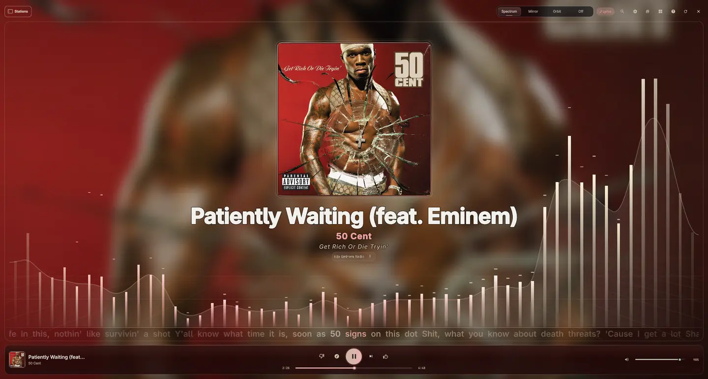
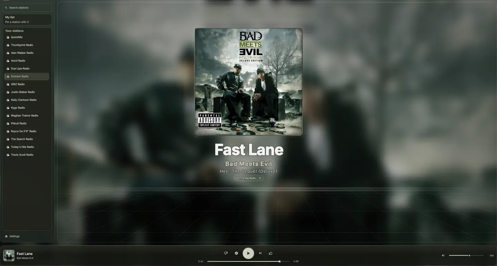

# Layout

Micro-Pandora is a Quickshell plugin with three entry points (`manifest.json`):

| Kind | File | Role |
| --- | --- | --- |
| Service | `qml-0.6.1/Service.qml` | Talks to Pithos, cava helper, pins |
| Bar widget | `qml-0.6.1/BarWidget.qml` | Music-note icon on the Omarchy bar |
| Panel | `qml-0.6.1/Panel.qml` | Large floating player |

## Bar

- Default section: **left**
- Left-click the music note to open the mini player.
- Right-click for the full player or middle-click to play and pause.

## Floating window

Hyprland can float and center a window titled `Micro-Pandora`.

The header holds the sidebar toggle, visualizer picker, mini player button, and shortcuts.

### Sidebar (left)

- **Search stations** opens a filtered station list.
- **My list** — pinned stations (Tab group 1)
- **Your stations** — remaining stations (Tab group 2)
- **Settings** opens Pandora sign-in and Pithos controls.

Press **Ctrl+B** or click the header’s sidebar icon to give the stage the full window width. Search and Settings move into the header while the sidebar is hidden.

### Main (right)

The stage centers the album cover, track details, and active station. Choose a visualizer mode in the header or press **V** to cycle through Spectrum, Mirror, Orbit, and Off. At shorter window sizes the artist and track move beside the cover.

### Footer

Transport, love / tired / ban, volume. Lights up with the big player when you
Tab to group 3.

## Theme

The current cover supplies up to seven swatches. Distinct hues tint the stage, station controls, playback, volume, and visualizers. Covers with fewer hues use lighter and darker shades of their own colors. Omarchy supplies the fallback palette and reduced-motion preference.

The full player spreads a softened, high-resolution copy of the original Pithos artwork across the backdrop. It keeps the previous artwork visible until a replacement has loaded.

## Screenshots

Each screenshot uses a different original demo cover and fictional track metadata. Select an image to open it at full size.

### Mini player

Left-click the music note in the Omarchy bar to see the current track, transport controls, and volume.

### Full player

Right-click the music note or open Micro-Pandora from the app launcher. The full player adds station browsing and the visualizer picker.

### Spectrum

A frequency trace with peak markers shows how the audio changes across the spectrum.

### Mirror

Layered waveforms reflect across the stage.

### Orbit

Projected rings and radial bands respond to bass hits.

### Off

Turns off the visualizer and audio capture while Pandora keeps playing.

